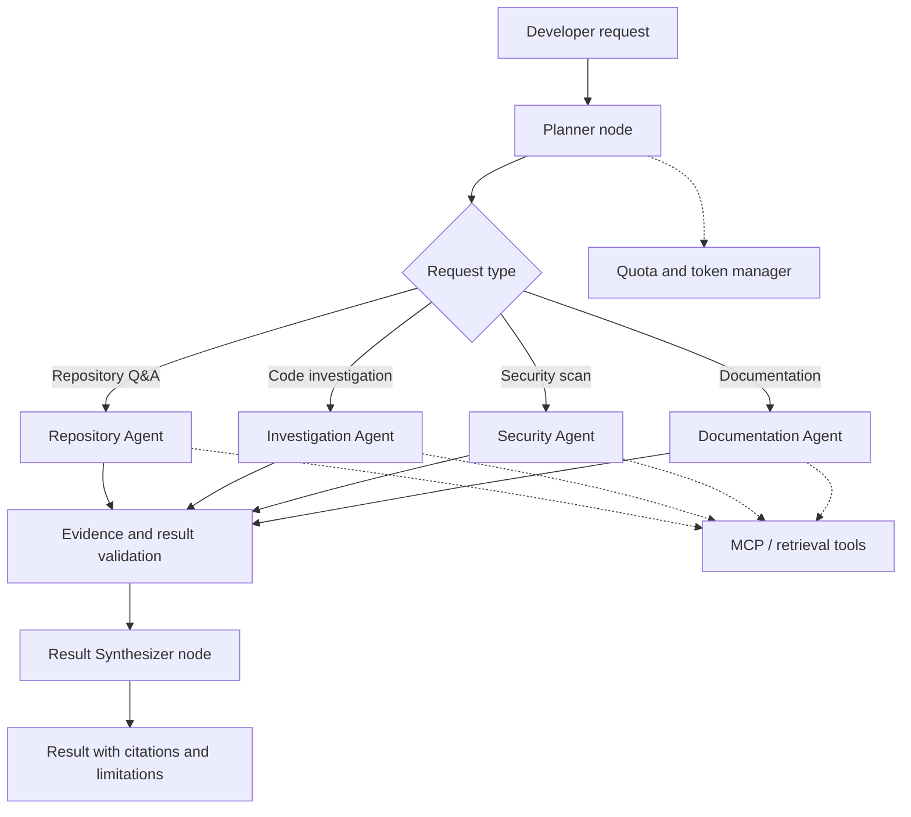
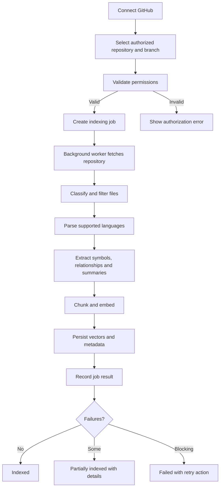
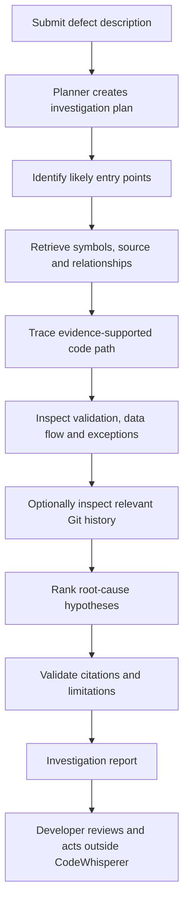
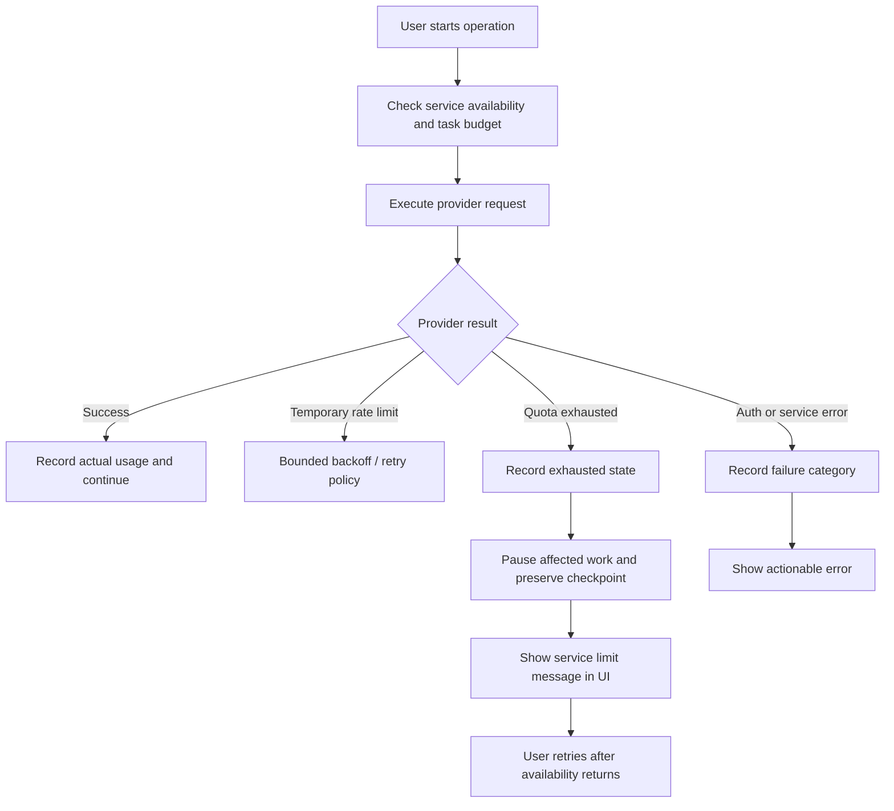
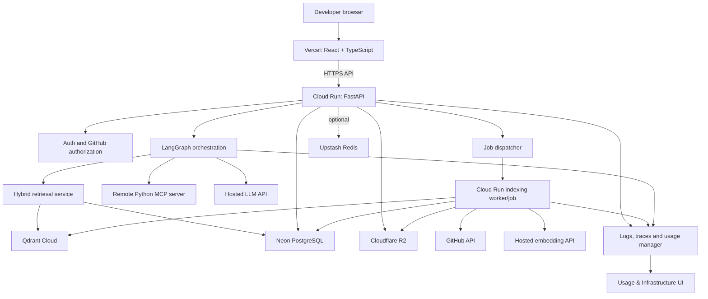

\newpage

## Document conventions

This PRD distinguishes established decisions from recommendations and unresolved choices:

- **Confirmed:** Explicitly agreed in the project discussions and treated as the product baseline.
- **Recommended:** A concrete implementation recommendation that fits the agreed architecture but still requires engineering validation.
- **TBD:** A decision that must be made before the dependent work is implemented.

The terms **MUST**, **SHOULD**, and **MAY** are used in their usual requirements sense. MUST indicates a release requirement; SHOULD indicates a strong recommendation that can be varied with documented reasoning; MAY indicates an optional capability.

## Contents

1. Product Overview  
2. Scope and Boundaries  
3. User Personas and Roles  
4. Functional Requirements  
5. AI Agent and Workflow Specifications  
6. End-to-End User Workflows  
7. System Architecture  
8. Data Requirements  
9. API and Integration Requirements  
10. Non-Functional Requirements  
11. Error Handling and Edge Cases  
12. Acceptance Criteria and Testing  
13. Development Roadmap  
14. Risks, Assumptions and Open Questions  
15. UI/UX Product Design Specification  
16. Implementation Readiness Assessment

\newpage

# 1. Product Overview

## 1.1 Product identity

**Product name:** CodeWhisperer  
**Product category:** AI-assisted software engineering and repository intelligence platform  
**Primary interface:** Cloud-hosted web application

## 1.2 Product vision

Help developers understand unfamiliar or complex codebases, investigate code-level defects, identify security concerns and produce useful technical documentation through evidence-grounded retrieval and coordinated AI agents.

CodeWhisperer is intended to shorten the time required to understand a repository and investigate a reported issue. It should make repository knowledge easier to access without pretending that an LLM has complete or infallible knowledge of the source code.

## 1.3 Problem statement

Developers working in mature or unfamiliar repositories often spend substantial time locating relevant files, understanding relationships between modules, following execution paths, finding dependency risks and assembling technical documentation. Repository knowledge may be distributed across source files, manifests, commit history and existing documentation. Traditional text search can locate terms but does not reliably explain how code elements relate or which evidence is relevant to a particular question.

Generic chat assistants can also produce unsupported answers when they receive incomplete repository context. Sending an entire repository to a model is inefficient, expensive and constrained by context windows. Large agent workflows can compound these problems when agents repeat retrieval or pass oversized context to one another.

## 1.4 Proposed solution

CodeWhisperer connects to GitHub repositories, indexes relevant repository content, extracts code structure, and makes the resulting knowledge available through a code-aware Retrieval-Augmented Generation (RAG) layer. A LangGraph workflow routes a developer's request to specialist agents. The agents retrieve repository evidence and use approved tools through Model Context Protocol (MCP) integrations. Results are consolidated with file and line references wherever available.

CodeWhisperer's MVP supports five specialist roles: Planner, Repository, Investigation, Security and Documentation. Result synthesis is a controlled orchestration node, not an additional autonomous agent.

The product is fully cloud-hosted. Repository indexing, backend processing, agent execution and data storage run in managed cloud services so the user can access the application from a browser without keeping a local machine running.

## 1.5 Product objectives

1. Make repository structure, key modules and code relationships easier to understand.
2. Provide grounded code search and natural-language repository Q&A with source references.
3. Help developers investigate likely code-level causes of reported defects.
4. Identify dependency vulnerabilities, outdated packages and selected insecure coding patterns.
5. Generate technical explanations and documentation from repository evidence.
6. Reduce unnecessary LLM context through code-aware indexing, retrieval controls, shared task context, caching and model routing.
7. Make agent execution, service health, usage and quota exhaustion understandable to the user.
8. Operate as a cloud-hosted application with a free-tier-first deployment strategy and graceful handling of exhausted service quotas.

## 1.6 Target audience

**Primary audience:** Individual software developers who need to understand, navigate or investigate an existing codebase.

**Secondary audience:** Technical leads, maintainers and engineers onboarding to repositories or reviewing architecture and dependency risks.

The initial product is primarily a developer-facing portfolio application. Organization-wide administration, enterprise SSO, granular team roles and centralized organizational policy management are not baseline MVP requirements.

## 1.7 Primary use cases

- Connect an authorized GitHub repository and index it.
- Ask questions about repository architecture, modules, classes, functions and dependencies.
- Search for code using natural language and receive relevant code evidence.
- Investigate a reported issue by tracing relevant code paths and identifying plausible failure points.
- Review dependency and code-pattern security findings.
- Generate architecture, module and technical documentation grounded in the repository.
- Inspect agent execution and tool activity.
- Monitor infrastructure service health, quota usage and exhausted free-tier limits from one place.

## 1.8 Expected value and differentiators

| Area | Expected value | Differentiator |
|---|---|---|
| Repository understanding | Less time locating and understanding code | Structural extraction combined with code-aware retrieval |
| Investigation | More focused defect investigation | Evidence-led execution-path and dependency reasoning rather than generic advice |
| Security | More accessible view of dependency and selected code risks | Findings linked to the affected package or source location |
| Documentation | Faster creation of repository-specific explanations | Generated content grounded in indexed repository context |
| Agent workflow | Clearer division of work | Specialist agents coordinated through explicit LangGraph state and routing |
| Efficiency | Less repeated context and retrieval work | Token budgets, deduplication, caching, incremental indexing and model routing |
| Operations | Better visibility into platform limitations | Centralized Usage & Infrastructure page and graceful free-quota handling |

## 1.9 Product success measures

Targets are **TBD** until a representative repository set and evaluation baseline are established. CodeWhisperer SHOULD measure:

- Repository indexing success rate and duration.
- Incremental indexing accuracy: changed files are re-indexed and unchanged files are not needlessly re-embedded.
- Retrieval quality using Recall@K and MRR on a curated query set.
- Answer quality, faithfulness and citation accuracy on the same evaluation set.
- Investigation usefulness as judged against known issue scenarios and supporting evidence.
- Security finding correctness and false-positive rate for selected checks.
- Documentation completeness and factual grounding.
- Median and tail latency by workflow stage.
- LLM input/output tokens per task, retrieval payload size, cache hit rate and estimated model cost.
- MCP tool success rate and agent workflow completion rate.
- Accuracy and freshness of the Usage & Infrastructure dashboard.

No performance, accuracy or token-reduction number should be advertised until it has been measured and recorded.

---

# 2. Scope and Boundaries

## 2.1 MVP scope

| Capability | MVP commitment | Explicit boundary |
|---|---|---|
| Account and GitHub connection | User can authenticate and connect GitHub access to repositories they are authorized to use | Authentication provider and final OAuth/App configuration remain TBD |
| Repository management | Add, view, index, refresh and remove connected repositories | No unrestricted access to repositories outside granted permissions |
| Repository contextualization | File classification, AST-based symbol extraction, relationships, summaries and repository metadata | Initial language support matrix must be finalized before implementation |
| Incremental indexing | Re-index changed files based on commit/change information | Full re-index remains available as a recovery action |
| Code-aware RAG | Semantic chunking, embeddings, metadata filtering, hybrid retrieval, reranking and source references | Graph RAG / Neo4j is deferred |
| Developer Q&A and code exploration | Ask repository questions and inspect relevant code evidence | Answers must distinguish source evidence from model inference |
| Multi-agent orchestration | Planner, Repository, Investigation, Security and Documentation roles through LangGraph | No Testing Agent and no Code Review Agent |
| Code-level investigation | Trace likely code paths, dependencies, data flow and exception handling from repository evidence | No runtime telemetry, browser console, network trace or live database evidence collection |
| Security analysis | Inspect dependency manifests for known risks and selected insecure code patterns | Exact vulnerability feeds and static-analysis engine require a pre-build decision |
| Documentation | Generate architecture, module and technical explanations | Generated output must be grounded in repository context and marked as generated |
| MCP integration | Custom Python MCP server with controlled repository and GitHub read tools | Write operations are not part of the default MVP; any later write action requires explicit approval |
| Observability and evaluation | Agent traces, tool logs, token metrics, latency and retrieval/answer evaluation | Do not expose secrets or raw sensitive source content in operational logs |
| Usage & Infrastructure dashboard | Central view of service usage, quota status, limits and health | Show provider-confirmed values separately from CodeWhisperer estimates |
| Cloud hosting | Fully cloud-hosted web app, API, workers and data stores | Free-tier-first; no paid fallback or automatic plan upgrade |

## 2.2 Supporting MVP features

- Task-specific context assembly and per-task token budgets.
- Token estimation before LLM calls and usage capture after calls, where provider response data is available.
- Dynamic Top-K retrieval, context deduplication and hierarchical summaries.
- Embedding, retrieval and result caching with repository-version-aware invalidation.
- Background indexing jobs with progress and resumable checkpoints where feasible.
- Service health monitoring, quota-exhaustion detection and clear UI messaging.
- Basic evaluation set management and repeatable baseline-versus-optimized comparisons.
- User-triggered retry after a service becomes available again.

## 2.3 Explicitly out of scope for MVP

| Excluded capability | Reason / boundary |
|---|---|
| Testing Agent or automated test generation | The developer remains responsible for writing tests. CodeWhisperer must not generate or modify test files. Existing test files may be retrieved and explained as repository context. |
| Code Review Agent or automated code review | Code review is intentionally excluded because the user expects to use GitHub Copilot Review for that workflow. |
| Automatic source-code fixes or source modification | CodeWhisperer explains issues and suggests remediation; it does not edit, commit or push source code. |
| Automated pull-request creation or issue creation | Write operations are not required for the MVP. Any later implementation must use explicit human approval and narrow permissions. |
| Runtime/contextual RCA | No collection or correlation of browser console logs, HAR/network traces, live database queries, application runtime logs, monitoring traces or browser-extension telemetry. |
| Graph RAG / Neo4j | Deferred future extension; the initial retrieval design uses vector and lexical/hybrid retrieval. |
| Jira, Slack and other work-management integrations | Not included in the initial integration set. |
| CI/CD automation | Not included in MVP. |
| Browser extension | Future enhancement only. |
| Incident history and cross-incident learning | Future enhancement only. |
| Enterprise RBAC, SSO and organization policy administration | Not required for the initial individual-developer product. |

## 2.4 Future enhancements

Future work MAY include Graph RAG and Neo4j, runtime/contextual RCA with approved telemetry sources, Jira/Slack integrations, CI/CD integration, browser extension, incident history, controlled GitHub issue/PR creation, broader language support and enterprise identity/administration. These items MUST remain outside MVP implementation unless the product scope is explicitly revised.

## 2.5 Product principles and non-negotiable boundaries

1. **Evidence before confidence:** Repository answers must be grounded in retrieved evidence; uncertain conclusions must be labelled as hypotheses.
2. **Read-only by default:** CodeWhisperer may inspect repositories and suggest changes, but it must not mutate source code or tests.
3. **Human ownership:** Developers decide what changes to make and whether to act on findings.
4. **Least privilege:** GitHub access and MCP tools must be scoped to the minimum required permissions.
5. **Cloud execution:** No feature may depend on a local CodeWhisperer daemon, local model, local vector database or user's laptop being online after deployment.
6. **Free-tier-first operation:** When a provider quota is exhausted, fail gracefully and ask the user to return after availability is restored; do not silently switch to a paid service.
7. **Honest telemetry:** Provider-reported figures and internally estimated figures must be visibly distinguished.

---

# 3. User Personas and Roles

## 3.1 Primary persona: Software Developer

**Goals:** Understand a repository, locate relevant code, investigate defects, identify dependency risk and document unfamiliar modules.

**Pain points:** Unfamiliar architecture, scattered context, expensive manual code navigation, repeated searches and large context requirements for AI tools.

**Typical interactions:** Connect a repository, ask questions, search code, run an investigation, inspect evidence and review suggested remediation.

## 3.2 Secondary persona: Technical Lead / Repository Maintainer

**Goals:** Understand system structure, inspect dependencies, assess architectural relationships and produce technical documentation for a team.

**Pain points:** Knowledge concentrated in a few engineers, onboarding overhead, stale documentation and difficulty assessing a large repository quickly.

**Typical interactions:** Review repository summaries, run security analysis, generate module documentation and inspect investigation findings.

## 3.3 Application roles

| Role | Permissions and responsibilities | MVP status |
|---|---|---|
| Authenticated developer / workspace owner | Connect and remove authorized repositories, launch analyses, view results, configure own integrations and inspect usage | Required |
| Platform operator | Troubleshoot deployment health and service configuration; not a separate customer-facing workflow | Operational role; detailed RBAC TBD |

The MVP SHOULD avoid a complex role matrix. Repository access must still be checked against the connected GitHub identity and token permissions. If multi-user workspaces are introduced, ownership and membership rules must be designed before enabling shared repositories.

---

# 4. Functional Requirements

Priority labels: **P0** = release blocker for MVP; **P1** = required supporting capability; **P2** = useful refinement within the agreed scope.

## 4.1 Identity and GitHub connection

| ID | Priority | Requirement | Acceptance criteria |
|---|---|---|---|
| FR-001 | P0 | The application MUST provide authenticated access to the CodeWhisperer web application. | Unauthenticated users cannot access repository data or protected APIs. Authentication provider is configurable and recorded as a pre-build decision. |
| FR-002 | P0 | A developer MUST be able to connect a GitHub identity or GitHub App installation. | Successful connection displays the identity and granted repository scope; failed or revoked authorization is communicated clearly. |
| FR-003 | P0 | CodeWhisperer MUST list only repositories available through the connected GitHub authorization. | A repository outside the granted scope cannot be added by guessing its owner/name or API identifier. |
| FR-004 | P0 | GitHub credentials MUST remain server-side and be stored securely. | No access token or client secret appears in browser-delivered code, logs or API responses. |
| FR-005 | P1 | Users MUST be able to disconnect GitHub and remove a repository from CodeWhisperer. | Disconnection invalidates stored credentials; repository removal schedules deletion of associated indexed content and metadata according to retention policy. |

## 4.2 Repository management

| ID | Priority | Requirement | Acceptance criteria |
|---|---|---|---|
| FR-006 | P0 | Users MUST be able to add an authorized repository and select the branch to index. | Repository identity, default branch and selected branch are visible before indexing starts. |
| FR-007 | P0 | The repository page MUST show indexing state and the latest successful index timestamp. | States include queued, indexing, completed, partially completed, failed and stale. |
| FR-008 | P0 | Users MUST be able to request a refresh or full re-index. | Duplicate indexing requests are deduplicated or safely serialized; the UI shows the active job. |
| FR-009 | P1 | CodeWhisperer SHOULD support incremental indexing based on commit/change information. | Changed and deleted files are reflected; unchanged files are not needlessly reprocessed. |
| FR-010 | P0 | Users MUST be able to remove a repository. | Associated vectors, source chunks, summaries and repository-specific metadata are removed or queued for verifiable deletion. |

## 4.3 Repository contextualization and indexing

| ID | Priority | Requirement | Acceptance criteria |
|---|---|---|---|
| FR-011 | P0 | The indexing pipeline MUST classify repository files and exclude irrelevant or unsafe-to-process content according to configurable rules. | Binary, generated, vendor and oversized files are handled by explicit rules; exclusions are recorded in the job summary. |
| FR-012 | P0 | The pipeline MUST extract code structure using language-aware parsing where supported. | Supported symbols include files, modules, classes, functions/methods, imports and selected call/dependency relationships. Unsupported syntax is reported rather than silently treated as fully parsed. |
| FR-013 | P0 | The pipeline MUST create code-aware chunks with source metadata. | Each chunk retains repository, branch/commit, file path and available line range. |
| FR-014 | P0 | The pipeline MUST produce repository and module summaries. | Summaries are linked to the repository version used to create them and can be regenerated after relevant changes. |
| FR-015 | P0 | Indexing MUST use background processing. | An API request creates/returns a job identifier; long-running clone, parse, embedding and indexing work does not block the request until completion. |
| FR-016 | P1 | The pipeline SHOULD support incremental re-indexing. | A commit update identifies changed files; only affected file chunks, symbols and summaries are refreshed, subject to dependency invalidation rules. |
| FR-017 | P1 | Indexing MUST checkpoint progress and report partial failures. | A failed file does not silently invalidate the whole repository; the UI lists the failure count and reason categories. |

**Language support:** Multiple languages are intended. The first-release language matrix is **TBD** and must be agreed before parser implementation. A language adapter interface is recommended so support can be added without rewriting the indexing pipeline.

## 4.4 Code-aware retrieval and developer Q&A

| ID | Priority | Requirement | Acceptance criteria |
|---|---|---|---|
| FR-018 | P0 | Users MUST be able to ask natural-language questions about an indexed repository. | The application retrieves relevant repository evidence and returns an answer or explains that sufficient evidence was not found. |
| FR-019 | P0 | Retrieval MUST combine semantic and lexical relevance. | Hybrid retrieval uses vector similarity and BM25-style lexical retrieval, followed by rank fusion such as RRF. Exact implementation of lexical indexing is an engineering decision. |
| FR-020 | P0 | Retrieval MUST support metadata filters. | Results can be restricted by repository, branch/commit, path and other available metadata. |
| FR-021 | P0 | The retrieval pipeline SHOULD support reranking and dynamic Top-K selection. | Retrieved evidence is ranked and constrained by a task token budget rather than an arbitrary fixed number of chunks. |
| FR-022 | P0 | Answers MUST provide source references when repository evidence supports the answer. | A citation identifies file path and line range where known; unsupported line references are not fabricated. |
| FR-023 | P0 | The UI MUST allow a user to inspect cited source context. | Selecting a citation opens the relevant file/chunk view and shows the referenced range where available. |
| FR-024 | P1 | Retrieval SHOULD use hierarchical summaries and deduplicate overlapping context. | Repeated or overlapping chunks are reduced without removing evidence required to answer the question. |

## 4.5 Multi-agent orchestration

| ID | Priority | Requirement | Acceptance criteria |
|---|---|---|---|
| FR-025 | P0 | LangGraph MUST orchestrate specialist agent workflows through explicit shared state. | State tracks user request, repository context, task plan, evidence, tool results, budget and final status. |
| FR-026 | P0 | A Planner MUST classify the request and route it to the appropriate specialist workflow. | A request can be routed to one or more suitable agents; unsupported requests receive a clear limitation message. |
| FR-027 | P0 | The Repository Agent MUST handle codebase understanding and repository Q&A. | Answers reference retrieved repository context and distinguish facts from inference. |
| FR-028 | P0 | The Investigation Agent MUST perform code-level root-cause investigation. | Output includes issue interpretation, relevant code path, evidence, likely failure points, confidence/limitations and suggested remediation. |
| FR-029 | P0 | The Security Agent MUST inspect dependencies and selected insecure code patterns. | Findings include affected package or location, severity where supported, evidence, source of vulnerability information and suggested remediation. |
| FR-030 | P0 | The Documentation Agent MUST generate technical documentation from repository evidence. | Output identifies repository/commit context and does not present unsupported architecture claims as facts. |
| FR-031 | P0 | Result synthesis MUST consolidate agent outputs and evidence. | The synthesizer reconciles duplicates, preserves citations and reports conflicting or incomplete evidence. It is a controlled graph node, not a separate autonomous agent. |
| FR-032 | P0 | Workflows MUST support conditional routing, sequential/parallel execution where useful, retries and failure handling. | Agent/tool failure is represented in workflow state and surfaced as partial failure or blocked completion. |
| FR-033 | P1 | The workflow SHOULD support human approval before any future write-capable GitHub action. | No write action executes without a distinct explicit approval event. Write operations remain out of MVP unless separately approved in scope. |

## 4.6 Code-level Investigation

| ID | Priority | Requirement | Acceptance criteria |
|---|---|---|---|
| FR-034 | P0 | A user MUST be able to submit a natural-language defect or error description against a selected repository. | The request is associated with a repository and branch/commit context. |
| FR-035 | P0 | The Investigation Agent MUST identify relevant modules, symbols and likely execution paths using indexed code structure and retrieval. | Each proposed path element is linked to source evidence or explicitly labelled as inferred. |
| FR-036 | P0 | The agent MUST examine relevant dependencies, data flow, validation and exception handling when evidence is available. | The report separates observed code facts from hypotheses and identifies missing evidence. |
| FR-037 | P1 | The agent SHOULD use available Git history to provide relevant change context. | Commit references are included only when the tool returns them and they are relevant to the investigated code. |
| FR-038 | P0 | The result MUST suggest remediation without changing repository files. | No source file, test file, branch, commit, issue or pull request is modified by the MVP investigation workflow. |
| FR-039 | P0 | The investigation report MUST show evidence, likely root cause(s), confidence/limitations and next steps. | A user can trace each material finding to source file/line or tool evidence. |

## 4.7 Security analysis

| ID | Priority | Requirement | Acceptance criteria |
|---|---|---|---|
| FR-040 | P0 | The Security Agent MUST identify dependency manifests and lockfiles supported by configured analyzers. | The scan lists analyzed, skipped and unsupported manifests. |
| FR-041 | P0 | The system MUST check dependencies against a selected vulnerability information source. | Each CVE/advisory claim includes its source identifier and timestamp/version where available; exact source integration is TBD. |
| FR-042 | P0 | The system MUST identify selected insecure patterns such as hardcoded secrets and risky coding patterns through configured static checks. | Findings include source evidence and rule identity; secrets are masked in UI and logs. |
| FR-043 | P0 | Findings MUST include severity, affected component/location, evidence and suggested remediation where available. | Unknown severity is shown as unknown, not guessed. |
| FR-044 | P1 | Users SHOULD be able to filter findings by severity, dependency, file and status. | Filters update the displayed findings and do not alter stored scan results. |
| FR-045 | P0 | Security analysis MUST be read-only. | The scanner does not update dependencies, edit source code or open PRs. |

**Potential implementation choices, not yet confirmed:** OSV or GitHub Advisory Database for dependency intelligence; Semgrep or another selected static-analysis engine for code patterns. The MVP requires a chosen source/engine, but this PRD does not treat either vendor as an already approved integration.

## 4.8 Technical documentation

| ID | Priority | Requirement | Acceptance criteria |
|---|---|---|---|
| FR-046 | P0 | Users MUST be able to request architecture, module and technical explanations for an indexed repository. | The request can target a repository or selected module/path. |
| FR-047 | P0 | Generated documentation MUST be based on indexed evidence and include source references where appropriate. | Unverified assumptions are labelled; generated content includes repository and commit context. |
| FR-048 | P1 | Users SHOULD be able to view, copy and export generated documentation. | Export format(s) are finalized before implementation; at minimum the content is viewable and copyable. |

## 4.9 MCP tools and integration management

| ID | Priority | Requirement | Acceptance criteria |
|---|---|---|---|
| FR-049 | P0 | CodeWhisperer MUST expose controlled repository/GitHub capabilities through a custom Python MCP server. | Tools have typed inputs/outputs, validation, permission checks, timeouts and structured errors. |
| FR-050 | P0 | The MVP MCP tool set MUST support repository structure, code search, file content and relevant commit/PR/issue retrieval where authorized. | Tool availability and permission failure are visible in agent activity; exact tool schemas are documented before implementation. |
| FR-051 | P0 | MCP tool calls MUST be logged with safe metadata. | Logs capture tool name, duration, success/failure and correlation ID without exposing secrets. |
| FR-052 | P0 | MCP endpoints MUST be authenticated and protected from unauthorized invocation. | Requests without valid credentials or required permissions are rejected. |
| FR-053 | P1 | Future write-capable tools MUST require explicit approval and narrow scopes. | Disabled by default; approval, actor and action outcome are auditable. |

**Candidate read tools:** `get_repository_structure`, `search_repository`, `search_code`, `get_file_content`, `get_commit_history`, `get_pull_request`, `search_github_issues` and `get_file_dependencies`. Exact tool contracts, pagination and supported inputs are implementation artifacts to define from actual provider APIs. No tool may return data that the connected GitHub identity is not authorized to read.

## 4.10 Token optimization, cost and observability

| ID | Priority | Requirement | Acceptance criteria |
|---|---|---|---|
| FR-054 | P0 | Each agent task MUST have a configurable token budget. | Before an LLM call, the system estimates input size and applies an explicit context budget. |
| FR-055 | P0 | The system MUST track input/output tokens and provider-reported usage when available. | Each call is associated with a task, model/provider and timestamp; unavailable figures are marked unknown or estimated. |
| FR-056 | P0 | The system MUST support dynamic Top-K, deduplication and task-specific context assembly. | The agent receives only context required for its current task; passing references alone is not counted as token reduction if content is resent. |
| FR-057 | P1 | The system SHOULD cache embeddings, retrieval results and suitable deterministic outputs. | Cache keys include repository/version/context and permission scope as appropriate; stale data is invalidated. |
| FR-058 | P1 | The system SHOULD support model routing by task complexity. | Simple classification can use a smaller configured model; complex investigation can use a stronger configured model. Routing is configurable and measured. |
| FR-059 | P0 | The system MUST record traces for agent steps, MCP calls and major retrieval stages. | A task can be inspected by correlation ID with durations and outcome, without unsafe secret logging. |
| FR-060 | P0 | The system MUST support baseline-versus-optimized evaluation. | The same curated query set is run under both configurations; tokens, latency and quality metrics are compared. |

**Optimization guardrail:** reducing tokens must not be treated as success if retrieval recall, citation accuracy or answer correctness materially deteriorates. Use a fixed evaluation set (initially 30–50 representative questions is a recommended starting point) and record measured outcomes. This number is a proposed evaluation-set size, not a quality guarantee.

## 4.11 Usage & Infrastructure dashboard

| ID | Priority | Requirement | Acceptance criteria |
|---|---|---|---|
| FR-061 | P0 | The application MUST provide a dedicated **Usage & Infrastructure** navigation item. | It opens a single page showing the configured external and cloud services used by CodeWhisperer. |
| FR-062 | P0 | The dashboard MUST show per-service health and quota/usage information. | Each service shows available metrics, current status, last updated time and data source. |
| FR-063 | P0 | The dashboard MUST distinguish provider-reported data from CodeWhisperer-tracked estimates. | The label identifies the source; estimated percentages are never presented as provider-confirmed quota. |
| FR-064 | P0 | The dashboard MUST support manual refresh and automatic refresh at a configurable interval. | Refresh time is visible; failed refresh does not overwrite the last known value without a stale indicator. |
| FR-065 | P0 | The system MUST detect and represent rate-limit and quota-exhaustion states. | Distinguishes temporary rate limiting, exhausted quota, authentication error, provider outage and unknown status where provider responses permit. |
| FR-066 | P0 | The UI MUST show a clear unavailable/come-back-later message when a required service quota is exhausted. | Message identifies the affected operation/service, whether existing features remain available, and reset time only when confirmed by provider. |
| FR-067 | P1 | The dashboard SHOULD show usage history and threshold warnings. | Daily/monthly trends and 80%/90% warnings are shown only when reliable usage/limit data exists. |
| FR-068 | P0 | The application MUST NOT automatically upgrade, purchase credits or switch to a paid fallback when a free quota is exhausted. | Exhaustion pauses the affected operation and surfaces a retry path. |
| FR-069 | P0 | Long-running jobs MUST preserve completed checkpoints where feasible when blocked by quota exhaustion. | The user can retry/resume without repeating completed work unnecessarily. |

**Service inventory to display when configured:** LLM provider, embedding provider, Qdrant, Neon PostgreSQL, Upstash Redis (optional), Cloudflare R2, GitHub API and Google Cloud Run/Cloud Monitoring. A service not configured for the current deployment must be labelled **Not configured**, not shown as operational. Redis is optional and should not be introduced solely to populate the dashboard.

## 4.12 Frontend application shell and navigation

| ID | Priority | Requirement | Acceptance criteria |
|---|---|---|---|
| FR-070 | P0 | The application MUST use a consistent persistent left sidebar and compact top header. | The active route is obvious; navigation is stable across pages. |
| FR-071 | P0 | The application MUST provide pages for Dashboard, Repositories, AI Workspace, Code Explorer, Security, Documentation, Agent Activity, MCP Tools, Usage & Infrastructure and Settings. | Pages are present only when the underlying workflow exists; irrelevant placeholder navigation is prohibited. |
| FR-072 | P0 | Every visible interactive control MUST have a defined action and state. | No decorative buttons, dead links or non-functional controls appear in production UI. |
| FR-073 | P0 | All major pages MUST implement loading, empty, success, partial-success, error and disabled states as applicable. | State-specific messaging and recovery action are testable. |
| FR-074 | P1 | The application SHOULD support responsive adaptation for tablet and mobile. | Sidebar collapse, readable data tables and accessible controls are provided. |

---

# 5. AI Agent and Workflow Specifications

## 5.1 Orchestration principles

LangGraph is the agreed orchestration framework. Each workflow uses a typed shared state and explicit nodes. The LLM is used for natural-language interpretation, planning and evidence-based synthesis. Deterministic application code handles authorization, repository identity, file parsing, token accounting, quota classification, state transitions, retries, schema validation and persistence.

Agents MUST NOT invent tool results, claim a file was inspected when it was not retrieved, or treat an inference as a verified source fact. Every tool call is permission-checked and bounded by timeout, input validation and a task correlation ID.

## 5.2 Shared workflow state

Recommended state fields:

| Field | Purpose |
|---|---|
| `task_id`, `user_id` | Correlate and authorize the request |
| `repository_id`, `branch`, `commit_sha` | Fix the repository context for the task |
| `user_request`, `request_type` | Original request and classified workflow |
| `plan` | Ordered specialist tasks and dependencies |
| `retrieved_evidence` | Code chunks, symbol metadata and source references |
| `tool_results` | Structured MCP and provider outputs |
| `agent_outputs` | Specialist findings and status |
| `token_budget`, `usage` | Estimated and actual token accounting |
| `service_constraints` | Rate limits, unavailable dependencies and quota blocks |
| `errors`, `warnings` | Recoverable and blocking failures |
| `final_result`, `task_status` | Synthesized answer and terminal state |

The implementation SHOULD keep state payloads compact. Large code bodies should be referenced by stable evidence IDs and loaded only by the node that needs them; do not resend a large repository context to every agent.

## 5.3 Planner Agent

- **Purpose:** Interpret the user's request, identify the appropriate workflow and produce a bounded plan.
- **Trigger:** Every new AI task.
- **Inputs:** User request, selected repository/branch/commit, available capabilities and current service availability.
- **Context:** Repository metadata and short summaries when helpful; no full repository dump.
- **Tools:** Normally no direct repository write tools. May request retrieval or a specialist node through orchestration.
- **Workflow:** Classify request as repository Q&A, code investigation, security analysis or documentation; identify dependencies; estimate task complexity; assign budget; route.
- **Decision authority:** Select workflow and task sequence only. It does not decide source-code changes.
- **Output:** Structured plan with task type, agents/nodes, required inputs, context needs, budget and expected deliverable.
- **Failure handling:** If classification is ambiguous, ask a concise clarification through the UI or route to safe repository Q&A with the ambiguity stated. If required service is unavailable, stop before expensive execution and report why.
- **Human intervention:** User chooses repository and initiates the request; no additional approval is required for read-only analysis.

## 5.4 Repository Agent

- **Purpose:** Answer questions about repository structure, modules, symbols, imports and dependencies.
- **Trigger:** Repository Q&A and code-exploration requests.
- **Inputs:** Request, repository scope and planner constraints.
- **Context:** Hybrid search results, AST/symbol metadata, module summaries and relevant existing documentation.
- **Tools:** Retrieval service and authorized read-only MCP tools such as structure, search and file retrieval.
- **Workflow:** Retrieve candidates; apply metadata filters; rerank/fuse; deduplicate; inspect necessary code; formulate grounded explanation.
- **Decision authority:** Explain repository evidence; cannot modify code or make security severity determinations without the Security workflow.
- **Output:** Answer, cited evidence list, inferred relationships and evidence gaps.
- **Failure handling:** Return a no-evidence or partial-evidence response rather than hallucinating.
- **Human intervention:** User can refine the question, open cited code or request a follow-up.

## 5.5 Investigation Agent

- **Purpose:** Perform code-level root-cause investigation for a reported issue.
- **Trigger:** User submits an error, defect or unexpected behaviour description.
- **Inputs:** Issue description, selected repository, branch/commit and relevant environment details supplied by the user (as text only).
- **Context:** Candidate modules/symbols, call/dependency relationships, relevant code chunks, exception handling, validation logic and optionally relevant Git history.
- **Tools:** Hybrid retrieval, symbol/dependency index, file content and commit-history MCP tools.
- **Workflow:**
  1. Restate the reported symptom and extract searchable terms/entities.
  2. Identify likely entry points, affected modules and relevant symbols.
  3. Retrieve source around those symbols and trace supported call/dependency paths.
  4. Inspect data passed between relevant functions, validation, null/empty handling, exception propagation and boundary conditions where visible in source.
  5. Use commit history if it is relevant and available.
  6. Develop and rank plausible failure hypotheses against the retrieved evidence.
  7. Synthesize root-cause candidates, evidence, confidence and limitations.
- **Decision authority:** Rank hypotheses and recommend diagnostic next steps. Does not claim runtime confirmation from static source alone.
- **Output:** Symptom summary; affected files/modules; execution path; evidence table; likely failure point(s); confidence/limitations; suggested remediation; follow-up checks for the developer.
- **Failure handling:** Explicitly report missing repository context, unsupported language parsing, insufficient call graph evidence, unavailable GitHub history or context-budget truncation.
- **Human intervention:** Developer validates findings and makes all code changes. CodeWhisperer does not edit source or tests.
- **Boundary:** This is code-level RCA only. Browser console, HAR/network traffic, application logs, monitoring telemetry and live database inspection are future work.

## 5.6 Security Agent

- **Purpose:** Identify known dependency vulnerabilities, outdated packages and selected insecure source patterns.
- **Trigger:** User launches a security scan or requests a security assessment.
- **Inputs:** Repository, branch/commit and scan configuration.
- **Context:** Dependency manifests/lockfiles, package metadata, selected source files and rule/advisory results.
- **Tools:** Manifest parsers, selected vulnerability-intelligence source and selected static-analysis engine. Exact external sources are TBD.
- **Workflow:** Detect manifests; normalize package coordinates and versions; query vulnerability source; run configured static rules; deduplicate and correlate results; classify severity only where source/rule provides it; prepare report.
- **Decision authority:** Explain findings and suggest remediation. Does not update dependencies or source code.
- **Output:** Finding ID, category, severity, package/file, installed version, fixed version where supplied, advisory/rule reference, evidence, rationale and remediation guidance.
- **Failure handling:** Show which manifests or files could not be analyzed and distinguish scanner errors from clean results.
- **Human intervention:** User reviews and chooses whether to remediate outside CodeWhisperer.

## 5.7 Documentation Agent

- **Purpose:** Generate useful technical documentation from indexed repository knowledge.
- **Trigger:** User requests architecture, module, component or technical explanation.
- **Inputs:** Documentation type, repository/module scope and optional audience/detail preference.
- **Context:** Module summaries, symbols, dependencies, retrieved source and existing docs.
- **Tools:** Retrieval and read-only repository tools.
- **Workflow:** Determine requested structure; retrieve evidence by section; draft content; verify material statements against citations; label assumptions and gaps.
- **Decision authority:** Select a suitable documentation structure within the user's request; cannot assert architecture not supported by evidence.
- **Output:** Structured documentation with scope, repository version, citations and known gaps.
- **Failure handling:** Produce a partial document with unverified sections clearly marked or stop if evidence is insufficient.
- **Human intervention:** User reviews and exports/copies the generated material.

## 5.8 Result Synthesizer (controlled LangGraph node)

- **Purpose:** Assemble specialist outputs into one coherent user-facing result.
- **Trigger:** Specialist nodes complete or reach a recoverable partial-failure state.
- **Inputs:** Agent outputs, retrieved evidence, tool results, warnings and budget status.
- **Processing:** Deduplicate findings; preserve traceable evidence; resolve simple overlaps; expose disagreements; label facts, inferences and unknowns; validate output schema.
- **Output:** Final response/report and structured result payload for the frontend.
- **Failure handling:** Return partial result with explicit incomplete status if one specialist fails. It must not invent a missing specialist result.

## 5.9 Deterministic services (not agents)

- **Authorization service:** Checks user and GitHub permissions.
- **Repository indexing service:** File enumeration, parsing, chunking, embedding orchestration and persistence.
- **Retrieval service:** Hybrid search, filtering, rank fusion, reranking and citation construction.
- **Token/usage manager:** Estimates and records tokens and provider usage.
- **Quota/availability manager:** Classifies provider status and blocks/resumes work as appropriate.
- **MCP gateway/server:** Validates and executes authorized tool calls.
- **Persistence and job services:** Own durable state and idempotent background processing.
- **Output validator:** Validates schema and required evidence fields before rendering.

## 5.10 End-to-end orchestration overview



---

# 6. End-to-End User Workflows

## 6.1 Connect and index a repository

1. User signs in and connects GitHub.
2. CodeWhisperer receives authorized repository metadata and displays available repositories.
3. User selects a repository and branch.
4. Backend validates access and creates an indexing job.
5. Background worker fetches repository content or uses authorized GitHub APIs; a temporary checkout may be used during processing.
6. The worker classifies files, excludes configured paths, parses supported languages, extracts symbols/relationships, creates semantic chunks and summaries.
7. Embedding and persistence steps write vectors to Qdrant and metadata/job state to PostgreSQL; generated artifacts may be stored in object storage where appropriate.
8. The job records counts, skipped files, errors and commit SHA.
9. UI updates to completed, partially completed or failed.
10. User opens the repository workspace and asks questions.



**Intermediate states:** queued, fetching, classifying, parsing, summarizing, embedding, persisting, completed, partial, failed, paused for quota. The exact progress events should be derived from job checkpoints, not fabricated percentages.

**Failure/recovery:** Retry transient fetch/API failures with bounded backoff. Keep completed checkpoints where safe. If embeddings or storage quota is exhausted, pause the affected stage and preserve previous successful index data. A full re-index is a user-triggered recovery option.

## 6.2 Ask a repository question

1. User opens a repository and enters a question.
2. Backend validates repository access and index readiness.
3. Planner classifies the request as repository Q&A.
4. Retrieval service creates search terms/query embedding, applies metadata filters, runs lexical/vector retrieval, merges and reranks results.
5. Repository Agent inspects only necessary code and relevant summaries.
6. Synthesizer validates source references and produces the response.
7. UI shows the answer, cited files/lines and relevant evidence; user can open a citation or ask a follow-up.

**Failure/recovery:** If the repository is not indexed, prompt the user to index it. If embeddings are unavailable but lexical retrieval is available, a lexical-only answer MAY be returned with the limitation disclosed. If no useful evidence is found, say so rather than answering from assumed repository facts.

## 6.3 Code-level root-cause investigation

1. User selects a repository and submits an issue description.
2. Planner creates an investigation plan and assigns a bounded token budget.
3. Investigation Agent identifies search terms, candidate entry points and related modules.
4. Retrieval and structure tools gather relevant symbols, source, dependency/call relationships and optional commit history.
5. Agent traces the code path supported by available evidence and examines validation, data flow and exception handling.
6. Agent ranks plausible failure hypotheses and records supporting/contradicting evidence.
7. Synthesizer produces a structured report.
8. UI displays progress, evidence, likely root cause, confidence/limitations and suggested remediation.
9. Developer validates the findings and makes any code changes independently.



**Example:** For a reported API 500, CodeWhisperer may trace a controller to service and repository methods, inspect data passed between them, and identify a potential null-handling or exception-propagation issue if the source supports it. It cannot confirm what happened in a live request without runtime evidence, which is outside MVP scope.

## 6.4 Security analysis

1. User launches a scan for a repository/branch.
2. Planner routes to Security Agent.
3. Deterministic scanner identifies supported dependency manifests and source files.
4. Dependency analyzer normalizes package names/versions and queries the selected advisory source.
5. Configured static rules inspect selected code patterns.
6. Security Agent correlates and explains results.
7. Synthesizer creates a finding list and summary.
8. UI displays severity, affected component, evidence, source and remediation guidance.
9. User decides how to address findings outside CodeWhisperer.

**Failure/recovery:** A missing advisory provider or scanner outage produces an incomplete scan status, not a clean bill of health. Unsupported manifests are listed.

## 6.5 Generate technical documentation

1. User chooses a repository/module and documentation type.
2. Planner routes to Documentation Agent.
3. Agent retrieves summaries, symbols, dependencies and relevant source.
4. Agent drafts the requested structure and verifies major statements against evidence.
5. Synthesizer labels gaps and assumptions.
6. UI presents document preview with citations and copy/export actions.
7. User reviews and reuses the content.

## 6.6 Inspect agent activity

1. User opens Agent Activity for a task.
2. UI retrieves safe trace events correlated to that task.
3. User sees planned steps, agent/node status, tool calls, durations, warnings and partial failures.
4. Sensitive source content, credentials and raw secrets are masked or omitted.
5. User can open the final result or retry a supported failed step.

## 6.7 Monitor service usage and handle quota exhaustion

1. Dashboard loads configured service inventory.
2. Backend obtains provider-reported metrics where supported and internal counters where not.
3. Each metric includes source type, measurement timestamp, freshness and status.
4. UI shows service health, usage, limit/remaining values when authoritative, and usage trends where reliable.
5. When an operation receives a provider quota error, the quota manager classifies the error and records an exhaustion event.
6. The affected task is paused or failed safely; unrelated features continue if their dependencies remain healthy.
7. UI identifies the unavailable service and blocked operation; it shows a reset time only when the provider confirms one.
8. User can retry after the service becomes available. No paid fallback is invoked.



The dashboard's overall service count and status must be calculated from configured services, not hardcoded. A service that has not been configured is shown as **Not configured**; one whose usage cannot be retrieved is shown as **Usage unavailable** or **Unknown**, not as zero.

---

# 7. System Architecture

## 7.1 Architecture decisions

| Component | Current baseline | Decision status / notes |
|---|---|---|
| Frontend | React + TypeScript | Confirmed project direction |
| Backend API | Python + FastAPI | Recommended deployment implementation for Python-based workflow |
| Agent orchestration | LangGraph | Confirmed |
| MCP server | Custom Python MCP server | Confirmed; remote deployment required |
| Frontend hosting | Vercel | Agreed free-tier-first deployment option; plan terms must be checked before public/commercial use |
| Backend and workers | Google Cloud Run services/jobs | Agreed cloud deployment option; quotas/regions to verify at deployment |
| PostgreSQL | Neon | Agreed candidate for managed metadata/relational data |
| Vector database | Qdrant Cloud | Agreed candidate for vector retrieval |
| Object storage | Cloudflare R2 | Recommended/selected in deployment discussion; verify current free allowance and API constraints |
| Cache | Upstash Redis | Optional; do not add until required |
| LLM/embeddings | Hosted provider APIs | Provider not finalized; local model is not part of production deployment |
| Graph database | None in MVP | Neo4j deferred with Graph RAG |

## 7.2 High-level architecture



## 7.3 Frontend architecture

- React + TypeScript single-page application.
- Shared application shell with sidebar, header, breadcrumbs and page-level action areas.
- Feature-oriented modules for repositories, AI Workspace, Code Explorer, Investigation, Security, Documentation, Agent Activity, MCP Tools, Usage & Infrastructure and Settings.
- Shared design tokens and reusable form, table, status, empty-state, error-state and progress components.
- API client layer with typed request/response contracts and centralized error mapping.
- Server state and client interaction state must be separated. Recommended libraries for routing, server cache and local state are TBD; select one consistent stack rather than introducing overlapping tools.
- All provider credentials and privileged API calls remain in backend services.

## 7.4 Backend architecture

Recommended logical modules:

1. **API layer:** Authentication middleware, request validation, rate limiting and response shaping.
2. **Repository service:** Repository registration, permissions, branches and refresh orchestration.
3. **Indexing service:** Background job creation, parsing, chunking, embedding and index persistence.
4. **Retrieval service:** Query embedding, lexical search, vector search, fusion, reranking and citations.
5. **Agent service:** LangGraph graph construction, task state and specialist nodes.
6. **MCP service:** Tool discovery, schema validation, authorization and execution.
7. **Security service:** Manifest parsing, advisory lookup and static-rule execution.
8. **Documentation service:** Document requests, generation and export.
9. **Usage/quota service:** Provider adapters, internal counters, quota state and dashboard aggregation.
10. **Observability service:** Structured logs, traces, usage events and evaluation records.

## 7.5 Background processing

Repository cloning/fetching, AST parsing, chunking, embedding and large scans MUST run outside synchronous API requests. A Cloud Run worker/job consumes durable job records. The API creates and reports jobs; the worker performs work and writes checkpoints. The implementation must decide the queue mechanism (for example, a managed task/queue service or PostgreSQL-backed job queue) before production implementation. Do not assume an in-memory queue is durable across serverless instance restarts.

## 7.6 MCP deployment and communication

MCP servers must be reachable remotely from the cloud-hosted backend. A remote HTTP-based MCP transport (such as Streamable HTTP) is the recommended deployment direction; confirm protocol/library support and authentication design during implementation. MCP is not a public unauthenticated endpoint. Every tool call must have an authenticated principal, repository scope and correlation ID.

## 7.7 Cloud deployment model

**Required operational behaviour:**

- Frontend, API, indexing workers, databases, vector store, object storage and MCP server run in cloud services.
- The application remains accessible from supported browsers while the user's laptop is offline.
- No local Ollama, local Qdrant, local PostgreSQL or local MCP process is needed in the deployed application.
- All background processing runs in managed cloud infrastructure.
- Deployments should start on free tiers or free allowances where available.
- If any service's free quota is exhausted, CodeWhisperer blocks the affected operation and communicates the state. It does not automatically upgrade or invoke a paid alternative.

**Free-tier caveat:** Free plans, quotas, eligibility and suspension rules are controlled by each provider and can change. This PRD does not guarantee permanent zero-cost or always-on service. Provider plan limits must be rechecked at deployment time. The application-level policy is to stop gracefully rather than incur unapproved charges.

## 7.8 Authentication and authorization

- Use an application authentication mechanism (provider TBD) for CodeWhisperer sessions.
- Use GitHub OAuth or GitHub App authorization for repository access; select the final mechanism and scopes before implementation.
- Verify repository-level permissions on every operation, not only at connection time.
- Store tokens/secrets server-side using the platform's secret-management facility.
- Separate user/session authorization from provider service credentials.
- Scope MCP tools to the repository and actions authorized for the active user.
- Ensure cached content is partitioned by repository and permission context; do not return one user's private repository content to another.

## 7.9 Logging and observability

Structured events SHOULD include task ID, user ID (internal identifier), repository ID, agent/node, tool, provider, model, timestamp, duration, outcome, token counters and error category. Logs MUST NOT contain access tokens, API keys, unmasked secrets or unnecessary full source files. Traces should connect frontend request, API request, graph execution, MCP call and background job where possible.

---

# 8. Data Requirements

## 8.1 Core entities

| Entity | Key fields (indicative) | Purpose / storage |
|---|---|---|
| User | `id`, auth subject, created/updated timestamps | App identity in PostgreSQL |
| GitHubConnection | `id`, user ID, provider identity, encrypted credential reference, scopes, status | GitHub authorization metadata in PostgreSQL; secret material in secret store |
| Repository | `id`, owner/name, provider repository ID, visibility, default branch, connected user, status | Repository registry in PostgreSQL |
| RepositoryVersion | `repository_id`, branch, commit SHA, indexed timestamp, index version | Version and index freshness tracking |
| IndexJob | `id`, repository/version, status, stage, checkpoint, counts, error category, timestamps | Durable background-job tracking in PostgreSQL |
| FileRecord | `id`, repository/version, path, language, size, content hash, parse status | File metadata in PostgreSQL |
| SymbolRecord | `id`, file ID, symbol kind/name, qualified name, line range, relationships | AST-derived code structure in PostgreSQL or selected graph-like relational representation |
| CodeChunk | `id`, file/version, text or payload reference, line range, metadata | Chunk metadata in PostgreSQL and/or Qdrant payload; actual storage choice TBD |
| EmbeddingRecord | chunk ID, embedding model/version, vector reference | Vector in Qdrant; metadata in PostgreSQL |
| Summary | repository/module scope, text, version, evidence references | PostgreSQL or object storage; version-aware |
| Conversation | `id`, user, repository, created timestamp | PostgreSQL |
| Message | `id`, conversation, role, content, citations, created timestamp | PostgreSQL; sensitive content retention policy TBD |
| AgentTask | `id`, conversation, task type, state, plan, result, budget, status | PostgreSQL |
| EvidenceItem | `id`, task, source type, file/path/lines/commit/tool reference, excerpt hash | PostgreSQL; referenceable from output |
| SecurityScan | `id`, repository/version, status, scanner/source versions, timestamps | PostgreSQL |
| SecurityFinding | `id`, scan, category, severity, package/file, advisory/rule ID, evidence, remediation | PostgreSQL |
| GeneratedDocument | `id`, repository/version, type, content/object key, citations, timestamp | PostgreSQL metadata + R2 content when exported |
| MCPToolCall | `id`, task, tool, safe arguments summary, duration, outcome, error category | PostgreSQL/logging system |
| ServiceDefinition | service key, provider, configured state, capabilities | PostgreSQL/configuration |
| UsageEvent | service, metric, quantity, unit, source type, task, timestamp | PostgreSQL or telemetry store |
| QuotaSnapshot | service, usage, limit, remaining, reset time, source type, measured time, confidence/freshness | PostgreSQL/cache for dashboard |
| ServiceStatusEvent | service, status, category, observed time, correlation ID | PostgreSQL/logging system |
| AuditEvent | actor, action, resource, outcome, timestamp | PostgreSQL or audit log |

Field names are indicative. Final normalization, indexes, partitioning and retention settings are implementation decisions.

## 8.2 Data relationships

- A user can have one or more GitHub connections.
- A GitHub connection can authorize access to multiple repositories.
- A repository has multiple indexed versions/branches and indexing jobs.
- A repository version contains file records; file records contain symbol records and code chunks.
- Code chunks map to vector records and source line ranges.
- Conversations and agent tasks are associated with a user and, where relevant, a repository/version.
- Agent tasks can produce evidence items, MCP calls, security findings or generated documents.
- Usage events and quota snapshots are associated with a configured service and may reference a task.

## 8.3 Example API payload schemas

**Index job request (indicative):**

```json
{
  "repository_id": "repo_123",
  "branch": "main",
  "mode": "incremental"
}
```

**Index job response (indicative):**

```json
{
  "job_id": "idx_456",
  "repository_id": "repo_123",
  "status": "queued",
  "branch": "main",
  "requested_mode": "incremental"
}
```

**Evidence item (indicative):**

```json
{
  "evidence_id": "ev_001",
  "source_type": "repository_file",
  "repository_id": "repo_123",
  "commit_sha": "<commit-sha>",
  "file_path": "src/services/example.py",
  "line_start": 42,
  "line_end": 59,
  "excerpt": "<retrieved source excerpt>",
  "retrieval_method": "hybrid"
}
```

**Quota snapshot (indicative):**

```json
{
  "service_key": "llm_provider",
  "status": "quota_exhausted",
  "usage": {
    "value": 1000,
    "unit": "requests",
    "source_type": "provider_reported"
  },
  "limit": null,
  "remaining": null,
  "reset_at": null,
  "measured_at": "2026-11-13T06:00:00Z",
  "freshness": "current"
}
```

Null values are intentional where a provider does not expose a reliable limit, remaining quota or reset time. The UI must not infer these values.

## 8.4 Data validation and versioning

- Validate all user inputs, tool arguments, provider responses and agent outputs against explicit schemas.
- Associate code evidence and generated summaries with a repository commit/version.
- Invalidate or refresh embeddings and caches when source content or embedding model version changes.
- Preserve repository path normalization and line-number consistency.
- Validate provider-reported quota fields and timestamp units before persistence.
- Treat provider responses and repository content as untrusted data, not instructions.

## 8.5 Retention and deletion

Retention periods are **TBD** and must be set before public use. Baseline expectations:

- Users can remove a repository and request deletion of its indexed content, vectors, summaries, documents and derived metadata.
- Deleting a GitHub connection prevents future API access and should trigger a clear decision about whether associated repository data is also deleted; recommended default is to offer/remove associated data.
- Temporary repository workspaces are deleted after processing and must not become permanent untracked clones.
- Logs retain operational metadata only as long as needed; sensitive content is excluded or masked.
- Deletion jobs are auditable and report completion/failure.

## 8.6 Data security and privacy

- Encrypt data in transit and use provider-managed encryption at rest where available.
- Store tokens and secrets in a secret manager, not source code, database plaintext or browser storage.
- Restrict object and vector-store access to backend services.
- Partition all repository-derived data by user/authorized scope.
- Mask secrets found during security scans in displays and logs.
- Define data retention, deletion and backup behaviour before onboarding private repositories.
- Do not use private repository content for model training; provider data handling and retention terms must be reviewed before selecting an LLM/embedding provider.

---

# 9. API and Integration Requirements

The endpoint list below is a **proposed CodeWhisperer API contract**, not an existing deployed API. Paths may be adjusted while preserving the described behaviour. All endpoints use HTTPS, JSON unless file download is required, and authenticated access. Repository-specific endpoints must enforce repository permissions.

## 9.1 Proposed REST API surface

| Endpoint | Method | Purpose | Key request / response behaviour |
|---|---|---|---|
| `/api/v1/auth/session` | GET | Get current session | Returns authenticated user summary or 401 |
| `/api/v1/integrations/github/connect` | POST | Start GitHub authorization | Returns authorization URL/state; exact flow TBD |
| `/api/v1/integrations/github/callback` | GET | Complete GitHub authorization | Validates state and stores server-side credential reference |
| `/api/v1/integrations/github` | GET | List connected GitHub identities | Never returns access tokens |
| `/api/v1/integrations/github/{connection_id}` | DELETE | Disconnect GitHub | Revokes/removes stored connection as supported |
| `/api/v1/repositories` | GET | List authorized/connected repositories | Supports search/filter/pagination |
| `/api/v1/repositories` | POST | Register a repository | Validates GitHub authorization and repository identity |
| `/api/v1/repositories/{repository_id}` | GET | Repository details/status | Includes selected branch, last indexed commit and index status |
| `/api/v1/repositories/{repository_id}` | DELETE | Remove repository | Starts deletion workflow for derived data |
| `/api/v1/repositories/{repository_id}/index-jobs` | POST | Start full/incremental indexing | Returns durable job ID |
| `/api/v1/index-jobs/{job_id}` | GET | Read indexing progress | Returns checkpoint, counts and safe error information |
| `/api/v1/repositories/{repository_id}/branches` | GET | List authorized branches | Provider-backed list |
| `/api/v1/chat/query` | POST | Ask repository question | Returns task ID or synchronous accepted response; long tasks are async |
| `/api/v1/investigations` | POST | Start code-level investigation | Returns task ID |
| `/api/v1/security/scans` | POST | Start security analysis | Returns scan/task ID |
| `/api/v1/security/scans/{scan_id}` | GET | Read scan summary/findings | Includes partial status and analyzer sources |
| `/api/v1/documentation/generate` | POST | Generate technical documentation | Returns task ID |
| `/api/v1/tasks/{task_id}` | GET | Read task state/result | Includes status, progress events and output reference |
| `/api/v1/tasks/{task_id}/events` | GET | Stream/poll task events | SSE or polling mechanism TBD; safe structured events only |
| `/api/v1/tasks/{task_id}/retry` | POST | Retry a recoverable task | Requires task state and idempotency validation |
| `/api/v1/agent-activity` | GET | List recent tasks and traces | Filter by repository, task type and status |
| `/api/v1/mcp/tools` | GET | List available MCP tools | Only tools enabled for the user/deployment |
| `/api/v1/mcp/tool-calls` | GET | Inspect tool-call history | Safe metadata, no secrets |
| `/api/v1/usage/overview` | GET | Get dashboard summary | Counts and statuses derived from configured services |
| `/api/v1/usage/services` | GET | Get service-level usage/status | Includes source type, freshness and unknown values |
| `/api/v1/usage/services/{service_key}/refresh` | POST | Refresh a service snapshot | Bounded provider request; subject to provider limits |
| `/api/v1/usage/history` | GET | Get historical metrics | Filter by service, metric and date range |
| `/api/v1/settings` | GET/PATCH | Read/update user settings | Only supported non-secret preferences exposed |

## 9.2 API response and error conventions

Recommended standard error shape:

```json
{
  "error": {
    "code": "PROVIDER_QUOTA_EXHAUSTED",
    "message": "The embedding service quota is exhausted. Repository indexing is paused.",
    "service": "embedding_provider",
    "retryable": false,
    "retry_after": null,
    "correlation_id": "req_abc123"
  }
}
```

- Use 400 for invalid input, 401 for unauthenticated access, 403 for unauthorized access, 404 for unknown/inaccessible resources, 409 for conflicting job/resource state, 422 for schema/validation errors, 429 for CodeWhisperer-level throttling, and 5xx for unexpected server/provider failures.
- Provider-specific quota and rate-limit codes must map to stable internal error categories.
- Do not expose raw provider stack traces, tokens, secret values or sensitive repository contents in error responses.
- Include correlation IDs in user-facing error details so support/debugging can trace the event.

## 9.3 External integration requirements

| Integration | Purpose | Authentication / security | Status |
|---|---|---|---|
| GitHub API | Repository discovery, source access, commits, PR/issue metadata | OAuth/App credentials; least-privilege repo scopes | Required; exact auth mechanism TBD |
| Hosted LLM API | Agent reasoning and synthesis | Server-side API key; provider data policy review | Required; provider TBD |
| Hosted embedding API | Vector creation/query embeddings | Server-side API key; version tracked | Required; provider TBD |
| Qdrant Cloud | Vector storage and similarity/hybrid retrieval | Backend-only credentials | Planned |
| Neon PostgreSQL | Application metadata, jobs, conversations, findings and usage | TLS and managed credential | Planned |
| Cloudflare R2 | Object storage for generated artifacts and selected files | Backend-only credentials; private bucket | Recommended/planned |
| Google Cloud Run | API, workers and remote MCP hosting | Cloud IAM/service identity | Planned |
| Google Cloud monitoring/logging | Runtime metrics and service health | Cloud IAM | Recommended; confirm integration details |
| Upstash Redis | Optional caching/short-lived state | Backend-only credentials | Optional; defer until justified |
| Vulnerability advisory source | Known dependency vulnerability data | Provider-specific API/public endpoint | TBD; choose before Security MVP |
| Static-analysis engine | Selected insecure source-pattern checks | Tool-specific configuration | TBD; choose before Security MVP |

## 9.4 GitHub MCP tool contracts

Each tool must have a documented JSON schema, permission scope, timeout, pagination behaviour, response-size limit and normalized error codes. Candidate tools:

- `get_repository_structure(repository, branch, path?)`
- `search_repository(repository, branch, query, filters?)`
- `search_code(repository, branch, query, language?, path_prefix?)`
- `get_file_content(repository, path, ref, start_line?, end_line?)`
- `get_commit_history(repository, path?, branch, limit?)`
- `get_pull_request(repository, pull_request_number)`
- `search_github_issues(repository, query, limit?)`
- `get_file_dependencies(repository, branch, file_path)`

MCP tool output must be normalized and size-bounded. Tool results are data; content retrieved from a repository is untrusted and must never override system or application instructions.

---

# 10. Non-Functional Requirements

| Category | Requirement |
|---|---|
| Performance | UI interactions should feel responsive. Long-running indexing, security scans and agent workflows must use asynchronous jobs with visible state. Numeric latency targets are TBD after deployment baseline. |
| Scalability | Services should scale independently where practical. Background work must be bounded by concurrency, provider quotas and repository-size controls. |
| Reliability | Jobs must be durable, idempotent where possible and recoverable after worker restarts. Partial completion must be represented explicitly. |
| Availability | Availability is constrained by free-tier provider plans and quotas. CodeWhisperer must expose service status and degrade gracefully; no uptime guarantee is asserted. |
| Security | Enforce least privilege, server-side secrets, TLS, authorization checks, input validation, secure logging and dependency hygiene. |
| Privacy | Private repository content must be isolated by authorization scope. Provider data-retention and training terms must be reviewed. |
| Maintainability | Use modular services, typed API contracts, language adapters, provider adapters and versioned schemas. |
| Extensibility | Add new languages, LLM/embedding providers, MCP tools and quota adapters without rewriting core workflows. |
| Observability | Correlate frontend request, agent graph, tool calls, indexing job and provider usage with trace/task IDs. |
| Usability | Show evidence, progress, task state, errors and recovery actions in context; avoid generic spinners and dead controls. |
| Accessibility | Support keyboard navigation, visible focus, semantic labels, sufficient contrast and responsive layout. |
| Cost control | Enforce free-tier-first behaviour and prevent unapproved paid fallback. Usage limits are tracked and affected operations stop when quota is exhausted. |
| Data portability | Repository-derived data and generated documents should have documented export/deletion pathways; exact formats TBD. |

## 10.1 Token and context management requirements

The token manager should:

1. Estimate prompt/context tokens before each model call using the provider-compatible tokenizer where available.
2. Apply a per-task and per-agent budget.
3. Reserve tokens for system instructions, user request and output budget before filling retrieved context.
4. Rank and truncate retrieved evidence to the remaining budget without cutting source references away from their chunks.
5. Record actual input/output usage from provider responses where available.
6. Mark estimated usage distinctly when provider usage is unavailable.
7. Track usage by task, agent, model and provider.
8. Stop or reduce optional work when a task budget is reached; do not silently drop essential evidence.
9. Compare baseline and optimized configurations on the same evaluation set.

Recommended optimization techniques: AST-aware indexing, semantic chunking, metadata filtering, hybrid retrieval, rank fusion, reranking, dynamic Top-K, hierarchical summaries, context deduplication, task-specific context, cache invalidation by repository version, embedding reuse and model routing.

## 10.2 Quota and service availability requirements

- Maintain a registry of configured services and supported usage/health metrics.
- Implement provider adapters only for services whose API exposes the needed data.
- Use provider-reported usage when available; otherwise use internal counters and label them as CodeWhisperer-tracked estimates.
- Track `measured_at`, source type, freshness, current status, limit, remaining and reset timestamp separately.
- Distinguish quota exhaustion from transient request rate limits, auth failures, service outages and unknown conditions.
- Use bounded retries with backoff for transient errors; avoid retry loops for hard quota exhaustion.
- Never infer reset time or remaining quota where provider data is unavailable.
- Do not make a paid request after quota exhaustion. Do not switch providers silently.
- Preserve completed work and allow user-initiated retry after service availability returns.

## 10.3 Accessibility and responsive design

- Desktop is the primary design target due to repository and evidence-heavy workflows.
- Sidebar may collapse to an icon rail on narrow desktop/tablet and become a drawer on mobile.
- Tables must support horizontal overflow or responsive row presentation without hiding key status/actions.
- Every icon-only control needs an accessible name and tooltip.
- Colour must not be the only status indicator; use text/icon labels as well.
- Keyboard users can reach navigation, controls, tables and dialogs with visible focus.
- Form validation is announced and associated with the relevant field.

---

# 11. Error Handling and Edge Cases

| Scenario | Required behaviour |
|---|---|
| GitHub authorization missing/revoked | Block repository access, explain reconnection, do not use stale credentials indefinitely. |
| Repository no longer accessible | Mark connection as access-lost; stop new indexing and retrieval; retain/delete cached data according to policy and user action. |
| Repository is empty or unsupported | Show a clear empty/unsupported result and list what was or was not processed. |
| Oversized, binary, generated or vendor files | Apply documented exclusion/size rules and report counts/reasons. |
| Parser cannot understand a file | Preserve raw file retrieval if safe, mark structural extraction as unsupported/partial and avoid false dependency claims. |
| Incremental diff unavailable | Offer or schedule full re-index only with clear state; do not claim incremental success. |
| Duplicate indexing request | Deduplicate or serialize; do not corrupt the active index. |
| Embedding provider timeout/quota | Pause embedding stage, preserve earlier checkpoints, mark service status and allow retry later. |
| Qdrant or PostgreSQL unavailable | Stop dependent operations safely; do not report empty search results as if the repository had no matches. |
| LLM timeout/context overflow | Apply bounded retry or context reduction once where appropriate; otherwise return a clear partial/error state. |
| LLM response malformed | Validate schema; retry within a bounded policy or return a structured failure. |
| Retrieved evidence conflicts | Show both sources and describe the conflict; do not force a false single conclusion. |
| Investigation lacks runtime evidence | Label findings as code-based hypotheses; state that runtime behaviour was not inspected. |
| Security source unavailable | Mark scan incomplete and identify unverified dependencies; never report a clean scan. |
| Static scan false positive | Allow user dismissal/annotation if included; do not silently remove the raw finding from scan history. |
| MCP tool timeout/permission error | Return normalized tool error, stop dependent node or use a permitted alternative; do not bypass access controls. |
| Quota exhausted | Mark the specific service exhausted, pause affected operation, preserve checkpoint and show “come back later” guidance. |
| Temporary rate limit | Apply bounded backoff and show temporary throttling if retry is not possible. |
| Quota status API unavailable | Display last known snapshot with stale timestamp or “usage unavailable”; do not display zero usage. |
| Service not configured | Show “Not configured” and identify which workflows depend on it. |
| Partial agent failure | Return successful specialist output with clear partial status and missing sections. |
| User removes repository during an active job | Cancel or invalidate work safely; ensure later job completion cannot recreate deleted data. |
| Cache contains stale/private data | Partition by permissions and repository version; invalidate on content or authorization change. |

## 11.1 User-facing message principles

Messages should identify the affected capability, explain what is blocked, say what remains available and give a valid next step. Avoid exposing stack traces, secret values or provider internals. Example:

> Embedding service quota exhausted. New repository indexing is paused. Previously indexed repository content may remain available. Try again after the provider quota becomes available.

Only show a specific reset time when it comes from a reliable provider response. Do not claim the user can retry at a guessed time.

---

# 12. Acceptance Criteria and Testing

This section covers testing CodeWhisperer as software. It does **not** add an AI Testing Agent or automated test-generation feature to the product.

## 12.1 Feature acceptance criteria

The MVP is acceptable when:

1. A user can authenticate and connect a GitHub account/repository with least-privilege access.
2. Repository indexing runs as a background job and returns durable status.
3. The index records supported file/symbol/chunk metadata and commit context.
4. A user can ask repository questions and receive grounded responses with file/line citations when available.
5. The Planner routes supported task types to the correct specialist workflow.
6. The Investigation Agent produces code-level hypotheses and evidence without changing repository files.
7. The Security workflow reports findings and incomplete scan states honestly.
8. The Documentation workflow produces source-grounded technical content.
9. MCP tools enforce authorization and expose safe trace metadata.
10. Token usage, task traces and key retrieval metrics are recorded.
11. Usage & Infrastructure displays configured services, source/freshness labels and quota/health state.
12. A quota-exhausted service blocks the affected action without paid fallback, and the UI shows a clear message.
13. The application runs fully in cloud services and remains usable without the developer's laptop running.
14. Deferred features remain absent from the MVP.

## 12.2 Functional and integration test areas

- Authentication session lifecycle and CSRF/state validation for GitHub callback.
- GitHub repository listing and permission boundary enforcement.
- Repository add/remove, branch selection and refresh flows.
- Indexing pipeline for supported, unsupported, binary, generated and large files.
- Incremental indexing for modified, added, deleted and renamed files.
- Vector and lexical retrieval, metadata filters, ranking/fusion, deduplication and citations.
- LangGraph routing for all supported request categories.
- Tool schema validation, permission failures, timeouts and pagination.
- Security advisory mapping, static-rule output and incomplete scan handling.
- Generated documentation citation checks.
- Usage dashboard with provider-reported, internally tracked, stale, unknown and not-configured metrics.
- Quota exhaustion, temporary 429, unauthorized provider, outage and retry/resume behaviour.
- Repository deletion and derived-data cleanup.

## 12.3 Agent behaviour evaluation

Create a curated evaluation dataset of representative repository questions, known code-path issues, dependency-risk fixtures and documentation prompts. Record expected evidence or acceptable evidence sets. Evaluate:

- Request classification/routing accuracy.
- Retrieval Recall@K and MRR.
- Citation precision and line-range correctness.
- Answer faithfulness and relevance.
- Investigation hypothesis quality and evidence traceability.
- Security finding correctness, severity-source fidelity and false-positive rate.
- Documentation factuality and coverage.
- Token usage, latency and workflow completion.

Agent prompts and model versions must be versioned so that evaluation changes are attributable.

## 12.4 Token optimization evaluation

Run the same query set with baseline and optimized retrieval/context settings. Compare input tokens, output tokens, total tokens, latency, retrieval quality, answer quality and citation accuracy. Calculate token reduction as:

`Token reduction (%) = ((baseline tokens - optimized tokens) / baseline tokens) × 100`

Report the result only after the experiment. An optimization is not accepted if it materially damages answer quality or citation reliability.

## 12.5 Security and privacy testing

- Verify no secret is delivered to frontend bundles or browser storage.
- Verify private repository data cannot be accessed through another user/session.
- Verify MCP endpoints reject unauthenticated and out-of-scope requests.
- Verify tool arguments and repository content cannot override system instructions.
- Verify secrets are masked in Security UI and operational logs.
- Verify deletion removes repository-derived data from supported stores.
- Verify rate limits and abusive request controls.
- Review chosen LLM/embedding provider's retention and training terms before private repository rollout.

## 12.6 UI acceptance checks

- Navigation groups are clear and active state is visible.
- Every control performs its labelled action.
- Data tables support loading, empty, error, filtering and pagination states where implemented.
- Long-running tasks show meaningful stage/progress updates.
- Partial success is distinct from full success.
- Usage dashboard differentiates estimates and provider-reported values.
- Quota messages identify blocked operation and service.
- Layout works at agreed desktop/tablet/mobile breakpoints and meets keyboard/focus/contrast requirements.

---

# 13. Development Roadmap

The original estimate was approximately 3–4 weeks for an ambitious portfolio build. That is a planning assumption, not a delivery commitment. The number of supported languages, security analyzers and cloud onboarding details can materially change effort. Prioritize a thin vertical slice and keep scope controlled.

## Phase 1: Foundation and MVP skeleton

- Create repository structure and engineering conventions.
- Build React + TypeScript application shell and design tokens.
- Establish FastAPI service, authentication approach and environment configuration.
- Provision PostgreSQL, Qdrant, object storage and Cloud Run environments.
- Implement GitHub connection and authorized repository listing.
- Define API schemas, repository entities and durable indexing job model.
- Create deployment pipeline and secret-management pattern.

**Exit criteria:** User can sign in, connect GitHub, add a repository and view a cloud-hosted repository record.

## Phase 2: Repository intelligence and core RAG

- Implement file classification and initial language adapters.
- Implement AST/symbol extraction for the first supported language set.
- Implement chunking, embeddings and Qdrant persistence.
- Implement lexical/hybrid retrieval, rank fusion and citations.
- Implement repository/module summaries.
- Implement background indexing progress and failure reporting.
- Implement repository Q&A and Code Explorer.

**Exit criteria:** A repository can be indexed in the cloud and queried with evidence-backed answers.

## Phase 3: Agent workflows, MCP and product capabilities

- Implement LangGraph shared state and Planner routing.
- Implement Repository, Investigation, Security and Documentation workflows.
- Implement remote Python MCP tools and authorization boundaries.
- Implement Security source/analyzer selection and findings UI.
- Implement Agent Activity and trace views.
- Implement token budgets, usage capture and core evaluation.

**Exit criteria:** All agreed read-only agent workflows complete end-to-end with traceable evidence and safe failure handling.

## Phase 4: Usage dashboard, resilience, polish and release

- Implement Usage & Infrastructure dashboard and provider/internal usage adapters.
- Implement quota classification, pause/retry and checkpoint recovery.
- Add caching/model routing where measured benefit justifies it.
- Complete security/privacy review and deletion behaviour.
- Complete UI responsive/accessibility pass and error/empty states.
- Run evaluation and token optimization experiments; record actual metrics.
- Validate free-tier configuration and confirm no paid fallback can be triggered.

**Exit criteria:** CodeWhisperer is deployed as a cloud-hosted portfolio application with honest quota status, reliable recovery and documented operational constraints.

## Future phase (not MVP)

Graph RAG/Neo4j, runtime/contextual RCA, Jira/Slack, CI/CD, browser extension, incident history, enterprise RBAC/SSO and approved GitHub write actions.

---

# 14. Risks, Assumptions and Open Questions

## 14.1 Technical and product risks

| Risk | Impact | Mitigation / decision needed |
|---|---|---|
| Free-tier limits or plan terms change | Application may become unavailable or require redesign | Use provider adapters; recheck terms before deployment; stop rather than trigger paid usage |
| Free services suspend or cold-start | First request/job may be slow or service temporarily unavailable | Show actual service state and handle startup/transient errors; do not claim always-on uptime |
| LLM/embedding provider unavailable or quota exhausted | AI tasks and indexing may stop | Quota manager, checkpoints, clear UI state and provider abstraction |
| Private repository exposure | High confidentiality risk | Least privilege, authorization on every request, encrypted secrets, tenant isolation, retention review and security testing |
| AST parser coverage gaps | Incomplete code structure and weaker investigation | Publish supported language matrix, report partial parsing and preserve raw retrieval fallback |
| Static code reasoning mistaken for runtime certainty | Misleading RCA | Label hypotheses and clearly state runtime evidence is not collected in MVP |
| False-positive security findings | Reduced trust | Show rule/advisory source and evidence; measure false positives; allow user review |
| Overly large agent context | Cost, latency and context errors | Token budgets, retrieval, deduplication, summarization and staged agent context |
| Inaccurate quota dashboard | User may believe service has more capacity than it does | Show source, freshness and unknown states; provider-reported data only where available |
| Serverless job interruption | Partial or duplicate indexing | Durable jobs, checkpoints, idempotency and deduplication keys |
| Scope creep | Schedule and reliability impact | Keep deferred features explicitly out of MVP; require change control |

## 14.2 Assumptions

1. GitHub is the initial source-control integration.
2. The user has authority to connect and inspect the repositories they add.
3. The product is primarily for individual developers and portfolio demonstration in its initial release.
4. React + TypeScript, LangGraph, Python and MCP form the baseline technology direction.
5. FastAPI, Cloud Run, Vercel, Neon, Qdrant Cloud and Cloudflare R2 are the current cloud deployment plan, subject to account eligibility and provider limits.
6. Hosted LLM and embedding APIs will be used; exact providers are not yet finalized.
7. The application will not pay for usage automatically or switch to a paid service after a quota is reached.
8. The screenshot's written visual characteristics are the design reference: minimal enterprise SaaS, light neutral surfaces, dark typography, subtle borders and restrained accent colour.
9. No local runtime service is required for deployed usage.

## 14.3 Open questions requiring decisions

| Question | Why it matters | Recommended timing |
|---|---|---|
| Which app authentication provider will be used? | Session security and user identity | Before Phase 1 auth implementation |
| GitHub OAuth App or GitHub App? | Scope, installation model and private repository access | Before Phase 1 integration |
| Which languages are supported in the first indexing release? | Parser selection and test fixtures | Before Phase 2 |
| Which LLM and embedding providers/models? | Tokenization, API contracts, quotas, data handling and cost | Before agent/RAG implementation |
| Which lexical search implementation? | BM25/hybrid architecture and operations | Before retrieval implementation |
| Which dependency advisory source and static analyzer? | Security feature correctness and API limits | Before Security Agent implementation |
| Which queue/job mechanism will run background indexing? | Durability and recovery on Cloud Run | Before Phase 2 worker implementation |
| What are retention periods for source chunks, conversations, traces and generated reports? | Privacy, storage and deletion | Before private repository onboarding |
| How will a disconnected GitHub identity affect previously indexed data? | Access and deletion semantics | Before repository-management release |
| Which provider usage APIs are available for each service? | Dashboard completeness and data accuracy | Before Phase 4 |
| How often should dashboard data refresh? | Provider rate limits vs freshness | Before Phase 4 |
| What export formats are required for generated documentation? | UI and storage implementation | Before Documentation release |
| What is the initial evaluation repository/query dataset? | Objective quality measurement | Before agent release |

## 14.4 Change control

Any decision to add source-code mutation, test generation, automated code review, runtime telemetry RCA, Graph RAG, new external integrations or paid fallback changes the agreed product boundary. Such changes require explicit scope revision and updated acceptance criteria before implementation.

---

# 15. UI/UX Product Design Specification

## 15.1 Design intent

The visual direction is a clean, minimal, professional enterprise SaaS interface. The application should feel like a mature developer tool: structured, information-dense and calm. The interface must prioritize repository workflows, evidence and task progress rather than decorative dashboards or a generic chatbot-first layout.

The PRD instructions refer to a screenshot as the primary visual reference. The pasted text supplied for this document describes its characteristics but does not embed the screenshot image itself. This specification therefore codifies the described visual language; the original image should also be retained in the project design-reference folder for direct comparison during implementation.

## 15.2 Visual language

### Layout

- Persistent left sidebar navigation.
- Compact top header with page title/breadcrumb and only relevant global actions.
- Main content area with controlled spacing and clear section grouping.
- Grid layouts for concise summaries; structured tables for data-heavy areas.
- Evidence and code views may use resizable split panes when this improves investigation flow.
- Avoid repeated cards when a table, list or plain section is clearer.

### Colour

- Primary canvas: white or very light neutral.
- Secondary surfaces: restrained light grey.
- Primary text: charcoal/near-black.
- Secondary text: muted grey.
- Borders/dividers: subtle neutral grey.
- One restrained primary accent for active navigation and important actions.
- Status colours reserved for meaningful success, warning, danger and informational states.
- No excessive gradient, glow or decorative colour blocks.

### Typography

- Modern sans-serif family.
- Clear compact hierarchy for page title, section title, body, field label and metadata.
- Avoid oversized hero typography inside operational pages.
- Use readable line length and consistent weights.
- Use tabular numerals for token counts, dates and usage metrics where available.

### Components

- Subtle card borders and minimal shadows.
- Small consistent corner radii.
- Compact, consistent button sizes.
- Clear form labels and validation.
- Tables with readable column spacing, alignment and predictable row actions.
- Consistent icon library; do not use emoji as interface icons.
- Badges only for genuine statuses or counts requiring emphasis.
- Loading skeletons and progress indicators used when they communicate real state.

## 15.3 Explicit anti-patterns

Do not use excessive purple/pink/blue gradients, pervasive glassmorphism, glowing borders, large decorative illustrations, oversized empty hero sections, overly rounded cards, nested cards without purpose, emoji icons, generic AI-chat templates, decorative charts without decisions attached, random component colours, excessive animations or repeated analytics cards on every page.

## 15.4 Navigation structure

Recommended left sidebar:

**Workspace**
- Dashboard
- Repositories
- AI Workspace
- Code Explorer

**Analysis**
- Investigations
- Security
- Documentation

**Operations**
- Agent Activity
- MCP Tools
- Usage & Infrastructure

**Configuration**
- Settings

Navigation labels must map to implemented functionality. If Investigation is a tab within AI Workspace instead of a top-level list page, consolidate it rather than duplicating routes. Do not add future-only sections such as Runtime RCA, Graph Explorer, Jira or CI/CD to the MVP sidebar.

Top header may contain breadcrumbs, repository/branch context, global search if implemented, notifications for task completion/quota warnings, and profile/settings. Do not place all controls in the top bar by default.

## 15.5 Global application shell

- Sidebar remains consistent across authenticated pages and supports collapse.
- Top header shows current page and relevant selected repository context.
- Main page begins with a compact title and short context sentence/action bar.
- Content width and density are tuned to the task; code/evidence pages may use wider layouts than settings forms.
- Notifications are actionable and link to the affected task/service.
- Navigation preserves useful context when switching between repository, code and investigation views.

## 15.6 Page-by-page design requirements

### A. Dashboard

**Purpose:** Give a concise operational starting point, not an ornamental analytics landing page.

**Main content:** Recent repositories and indexing state; recent AI tasks; active/failed jobs requiring attention; concise service-health summary; shortcuts to connect a repository or start an analysis.

**Primary actions:** Add repository, open repository, continue recent task.

**States:** First-use empty state with GitHub connection/add-repository action; loading; partial service outage; populated state. Avoid metrics that have no meaningful data source.

### B. Repositories

**Purpose:** Manage connected repositories and indexing lifecycle.

**Layout:** Page header with Add Repository; searchable/filterable table/list.

**Recommended columns:** Repository, visibility, default/selected branch, index status, latest indexed commit/time, language summary if known, last job, row actions.

**Actions:** Add, select branch, index/refresh, open workspace, view job, remove repository with confirmation.

**States:** No repositories, GitHub not connected, indexing, partially indexed, failed, stale and access revoked.

### C. Repository detail / AI Workspace

**Purpose:** Provide a repository-scoped entry point for questions and analysis.

**Layout:** Repository title and branch/commit context; compact index health/status area; primary question input and suggested task entry points; recent repository tasks; quick links to Code Explorer, Investigation, Security and Documentation.

**Interaction:** User submits a question or chooses a task type. Show the selected repository and branch clearly before execution. Do not create a generic full-screen chatbot with no repository context.

**States:** Not indexed, indexing, ready, stale index, unsupported branch, service unavailable.

### D. Code Explorer

**Purpose:** Inspect files and structural context retrieved from the repository.

**Layout:** Repository/file navigation pane, source viewer and contextual evidence/details pane. Search results should show path, symbol and snippet with match reason where available.

**Actions:** Search code, filter by path/language/symbol, open file, navigate to line range, follow symbol/dependency references where indexed.

**States:** No index, no matches, partial parser coverage, file unavailable, branch/commit mismatch.

### E. Investigation workspace

**Purpose:** Make code-level RCA the core guided analytical workflow.

**Layout priority:** Issue description and task context; execution progress/stage list; summary of likely cause; evidence-backed code path; findings/hypotheses; suggested remediation and limitations.

**Evidence presentation:** Each finding links to file path and line range, with a clear indication of source fact versus inference. A code path is presented as connected steps only when each step has source evidence; inferred edges are visibly labelled.

**Actions:** Start investigation, open cited file, expand evidence, copy/export report, ask follow-up. No Apply Fix, Edit File, Generate Test or Create PR action.

**States:** Planning, retrieving, tracing, analyzing, synthesizing, completed, partial, failed, paused due to quota.

### F. Security Center

**Purpose:** Present actionable dependency and selected code-pattern findings.

**Layout:** Scan scope and commit; scan status; concise counts by severity only when severity is supplied; findings table; finding detail panel.

**Suggested columns:** Severity, finding, package/file, installed version, fixed version if provided, advisory/rule, scan status.

**Actions:** Start scan, filter/sort, inspect evidence, copy/export findings. No auto-fix or dependency update action.

**States:** Not scanned, scanning, completed, incomplete, provider unavailable, no findings (only when all intended analyzers completed successfully).

### G. Documentation

**Purpose:** Generate and review technical documentation based on repository context.

**Layout:** Documentation type/scope controls; generation status; readable document preview; evidence/citation panel; export/copy actions.

**Actions:** Generate architecture overview, module explanation or technical document; regenerate with updated scope; copy/export.

**States:** No repository/index, generating, generated, partial evidence, export unavailable.

### H. Agent Activity

**Purpose:** Explain what CodeWhisperer did during a task.

**Layout:** Task list with type, repository, created time, duration, status; selected-task timeline with planner decision, agent/node steps, MCP calls, retrieval summary, warnings and outcome.

**Display policy:** Present meaningful progress and safe diagnostics, not raw chain-of-thought or unrestricted internal logs. Show action/tool summaries, inputs at a safe level and result status. Do not expose credentials or private source content unnecessarily.

**Actions:** Open final result, filter tasks, retry supported failures, copy correlation ID.

**States:** No tasks, active, completed, partial, failed, blocked by service.

### I. MCP Tools

**Purpose:** Provide transparency into available integrations and executed tools.

**Layout:** Tool registry/list, enabled state, short purpose, required permission, latest activity and status. Tool detail may show schema summary and recent safe call metadata.

**Actions:** Inspect tools and call history. Tool enablement/configuration is restricted to authorized settings and should not expose secrets.

**States:** No tools configured, connected, permission missing, tool degraded/unavailable.

### J. Usage & Infrastructure

**Purpose:** Give a single reliable view of the current usage and health of services powering CodeWhisperer.

**Overview strip:** Number of configured services operational, degraded, exhausted and unknown/not configured. Counts are computed from service registry.

**Service table:** Service, category, current status, usage metric, usage/limit or remaining when available, source type (provider-reported or CodeWhisperer-tracked), last synchronized time and action/details.

**Service detail:** Current and historical usage where available; unit and limit semantics; reset time only if provider-reported; recent quota/availability events; dependent CodeWhisperer features; link to provider console where a verified URL is configured.

**Expected service groups:** AI (LLM and embeddings), data (Qdrant, PostgreSQL, optional Redis, object storage), platform (Cloud Run) and integration (GitHub API).

**Actions:** Refresh all/individual service, open detail, inspect recent events. Refresh must be throttled to avoid consuming provider quotas. Automatic refresh interval is configurable and conservative.

**Status vocabulary:** Operational, Degraded, Rate limited, Quota exhausted, Authentication error, Unavailable, Usage unavailable, Unknown, Not configured. Use only states supported by actual signals.

**Data rules:**
- Provider-reported values are labelled as such.
- Internally tracked counters are labelled CodeWhisperer-tracked.
- Estimated values are labelled Estimated.
- Unknown or unavailable values are not represented as zero.
- Last known values show their timestamp and stale state.
- Reset dates are displayed only when returned reliably by the provider.

**Quota experience:** When a quota is exhausted, the affected page/task shows a contextual message and the usage page links to the service detail. Unrelated capabilities remain available if their dependencies are healthy. No paid upgrade or automatic provider switch is triggered.

### K. Settings

**Purpose:** Manage user preferences and connected integrations.

**Contents:** Profile/session; GitHub connections; notification preferences; default repository/branch preferences if supported; privacy/data deletion actions; integration status. Do not expose secret values; credential rotation is handled through the relevant provider flow.

## 15.7 Interaction patterns

- **Buttons:** Use action verbs; show disabled/loading states; prevent duplicate submissions.
- **Forms:** Label fields, validate inline and explain permission/format errors.
- **Tables:** Support sorting/filtering/pagination when data volume requires it; preserve row context and accessible headers.
- **Search:** Debounce interactive search where appropriate; show query scope and no-results state.
- **Modals:** Reserve for confirmations and focused decisions; do not put long workflows in modal dialogs.
- **Tabs:** Use for related views within a single entity (for example Overview / Files / Activity), not as a substitute for clear navigation.
- **Notifications:** Provide meaningful title, affected resource, status and navigation to details.
- **Expandable sections:** Use for evidence detail, trace detail and advanced configuration; keep primary conclusions visible.
- **Tooltips:** Explain units, status labels and unavailable metrics without hiding essential meaning.

## 15.8 Long-running task states

Use stage labels tied to actual backend events. For indexing, stages may include Fetching, Parsing, Extracting structure, Chunking, Embedding and Persisting. For investigation, stages may include Planning, Retrieving evidence, Tracing code, Analyzing hypotheses and Synthesizing. Show counts or percentages only if computed from known job work units. Otherwise show the current stage and elapsed time, not a fabricated progress bar.

## 15.9 Design system and component architecture

Define tokens before implementing pages:

- Colour tokens: canvas, surface, elevated surface, text-primary, text-secondary, border, accent, success, warning, danger, info.
- Typography tokens: family, scale, weights, line heights.
- Spacing tokens: consistent 4/8-point-derived scale.
- Radius tokens: small/medium/large with restrained values.
- Elevation tokens: minimal shadow levels.
- Layout tokens: sidebar width/collapsed width, header height, content max width, page gutters and breakpoints.

Build shared components: `AppShell`, `Sidebar`, `TopBar`, `PageHeader`, `Breadcrumbs`, `StatusBadge`, `DataTable`, `SearchField`, `FilterBar`, `EmptyState`, `ErrorState`, `LoadingSkeleton`, `TaskTimeline`, `ProgressStageList`, `EvidenceReference`, `CodeViewer`, `ConfirmationDialog`, `Toast/Notification`, `QuotaNotice` and `ServiceUsageTable`.

Use feature modules and shared primitives. Pages should compose common components instead of defining new visual patterns independently. Design tokens and component variants must be centralized.

## 15.10 Screenshot reference handling

The screenshot's described attributes are the visual baseline. During implementation, compare page layouts to the original reference image retained by the project owner. Reproduce the overall design language, not the screenshot's literal labels, metrics, charts or content.

---

# 16. Implementation Readiness Assessment

## 16.1 Sufficiently defined for development

- Product vision, primary user and core use cases.
- MVP boundaries and explicitly deferred capabilities.
- Five specialist agent responsibilities and the synthesizer's role as a graph node.
- Code-level Investigation Agent scope and non-runtime boundary.
- Read-only behaviour: no test generation, no automated code review and no source-code modifications.
- GitHub as the initial repository integration.
- Core RAG strategy: code-aware chunking, semantic and lexical/hybrid retrieval, metadata filters, reranking, dynamic Top-K, citations and incremental indexing.
- LangGraph orchestration and Python MCP integration direction.
- Cloud-hosted, free-tier-first deployment strategy and no paid fallback on quota exhaustion.
- Usage & Infrastructure dashboard requirements and quota-exhaustion UX.
- Enterprise-minimal UI direction and primary page inventory.

## 16.2 Decisions still uncertain

- Application authentication provider and exact GitHub OAuth/App model.
- First-release language/parser support matrix.
- LLM and embedding provider/model selection.
- Exact BM25/lexical indexing implementation and reranker choice.
- Vulnerability advisory source and static-analysis engine.
- Durable background queue mechanism and task event transport.
- Retention periods and precise repository deletion semantics.
- Which provider quota/usage APIs can supply authoritative metrics.
- Usage refresh cadence and supported history periods.
- Documentation export formats and final responsive breakpoints.

## 16.3 Must be decided before implementation

| Decision | Required before |
|---|---|
| App auth provider and GitHub auth mechanism/scopes | Phase 1 |
| Initial supported languages | Phase 2 parser work |
| LLM and embedding provider/model | RAG and agent implementation |
| Queue/job orchestration mechanism | Background indexing implementation |
| Lexical search and reranking implementation | Hybrid retrieval implementation |
| Advisory source and static scanner | Security workflow implementation |
| Data retention/deletion policy | Private repository onboarding |
| Provider usage APIs and status mapping | Usage dashboard implementation |

## 16.4 Dependencies and blockers

- Active accounts and project configuration for Vercel, Google Cloud, Neon, Qdrant Cloud and Cloudflare R2.
- Cloud billing/account setup may be required by providers even when staying within free allowances; deployment must be configured to prevent unapproved paid usage where provider controls allow.
- GitHub application registration and permission approval.
- LLM and embedding API credentials and review of data handling terms.
- A representative set of repositories for parser and RAG validation.
- A curated evaluation dataset for answer, retrieval and investigation quality.
- The original UI screenshot should be retained in the project reference set for direct visual QA.

## 16.5 Overall readiness

**Product scope: Ready for implementation planning.** The product's core boundaries, agent roles, workflows, cloud-first intent and UI philosophy are defined.

**Technical implementation: Ready with pre-build decisions.** The architecture direction is sufficiently clear, but authentication, provider/model selection, supported languages, job queue, lexical search and security analyzer choices must be finalized before the corresponding work begins.

**Release readiness: Not yet established.** It depends on real provider quotas, security/privacy review, measured retrieval/agent quality, resilient indexing and verified cloud quota behaviour. No performance, quality or zero-cost guarantee should be made until tested in the target deployment.

---

## Appendix A. MVP feature checklist

- [ ] User authentication and GitHub connection
- [ ] Authorized repository listing and repository management
- [ ] Branch selection and durable indexing jobs
- [ ] File filtering/classification and first-language parser adapters
- [ ] AST/symbol/dependency extraction
- [ ] Code-aware chunking, embeddings and Qdrant persistence
- [ ] Hybrid retrieval, reranking, metadata filters and citations
- [ ] Repository Q&A and Code Explorer
- [ ] LangGraph Planner and specialist agents
- [ ] Code-level Investigation workflow
- [ ] Security analysis with selected advisory/static-analysis sources
- [ ] Technical documentation generation
- [ ] Read-only Python MCP server and GitHub tools
- [ ] Agent Activity and structured traces
- [ ] Token budgets, usage tracking and evaluation harness
- [ ] Usage & Infrastructure dashboard
- [ ] Quota exhaustion detection, graceful pause and retry
- [ ] Cloud deployment and secret handling
- [ ] Repository deletion and derived-data cleanup
- [ ] UI accessibility, responsive behaviour and state coverage

## Appendix B. Explicitly prohibited in the MVP

- [ ] Testing Agent
- [ ] Automated unit/integration test generation
- [ ] Test-file modification
- [ ] Code Review Agent
- [ ] Automated code review workflow
- [ ] Automatic source-code edits, commits or pushes
- [ ] Automatic issue/PR creation
- [ ] Runtime RCA using browser console, HAR/network traces, application logs, live database queries or monitoring traces
- [ ] Graph RAG / Neo4j
- [ ] Jira/Slack, CI/CD or browser extension integrations
- [ ] Paid fallback, automatic upgrade or automatic credit purchase after free quota exhaustion

---

**End of Product Requirements Document**
